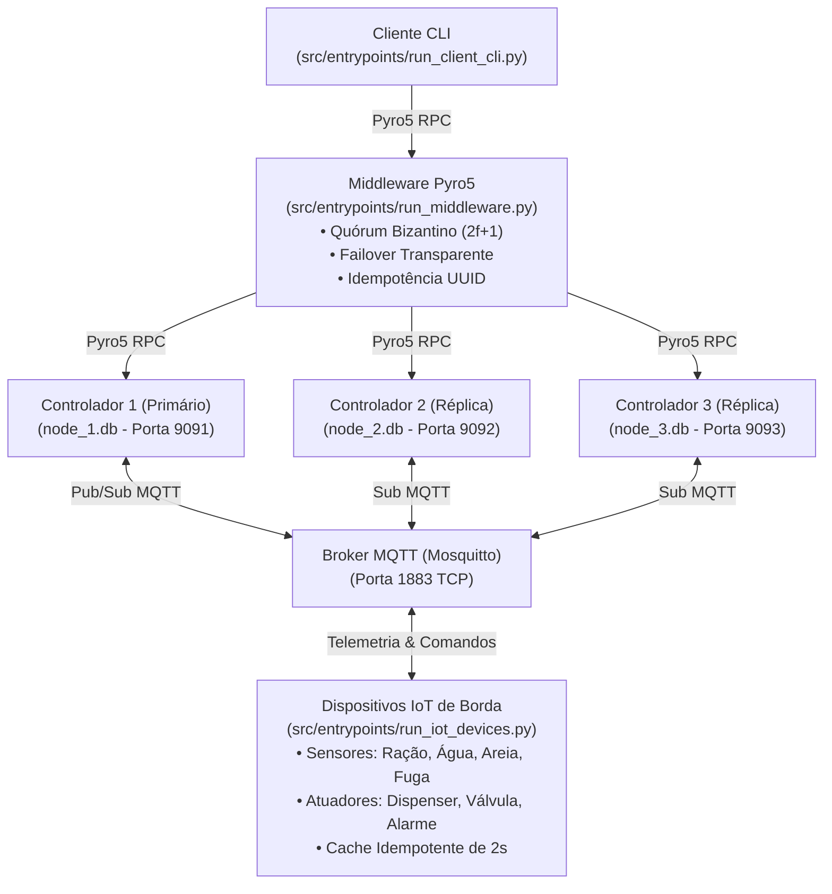

# Sistema IoT Distribuído de Pet Care

Trabalho Prático de Sistemas Distribuídos implementando controle autônomo, persistência com semântica *exactly-once*, consenso por quórum bizantino ($2f + 1$), failover transparente e comunicação desacoplada via RPC (Pyro5) e mensageria publish/subscribe (MQTT).

---

## 1. Arquitetura do Sistema



---

## 2. Pré-requisitos

1. **Python 3.10+** (com ambiente virtual `.venv`)
2. **Docker** (para subir o broker Mosquitto)

Instalação das dependências Python:
```bash
python3 -m venv .venv
source .venv/bin/activate
pip install -r requirements.txt
```

---

## 3. Passo a Passo de Execução em Tempo Real

Para executar o sistema completo com todos os seus nós interconectados, abra **6 terminais** diferentes na raiz do projeto (ou utilize abas de terminal):

### Terminal 0: Iniciar Broker MQTT (Mosquitto)
```bash
docker compose up -d
```
*(Certifique-se de que a porta `1883` está liberada no host).*

---

### Terminal 1: Iniciar Controlador 1 (Líder Primário)
O parâmetro `--id 1` indica a réplica 1 e `--primary` define que este nó é o líder ativo responsável por publicar comandos autônomos na borda:
```bash
.venv/bin/python src/entrypoints/run_controller.py --id 1 --primary
```

---

### Terminal 2: Iniciar Controlador 2 (Réplica Secundária)
```bash
.venv/bin/python src/entrypoints/run_controller.py --id 2
```

---

### Terminal 3: Iniciar Controlador 3 (Réplica Secundária)
```bash
.venv/bin/python src/entrypoints/run_controller.py --id 3
```

> **Nota sobre Falha Bizantina:** Caso queira simular falha bizantina de teste no nó 3, passe o argumento `--corrupt`:
> ```bash
> .venv/bin/python src/entrypoints/run_controller.py --id 3 --corrupt
> ```

---

### Terminal 4: Iniciar o Middleware
Conecta-se às 3 réplicas e expõe a interface remota consolidada com Quórum Bizantino e Failover:
```bash
.venv/bin/python src/entrypoints/run_middleware.py
```

---

### Terminal 5: Iniciar os Dispositivos IoT de Borda
Inicia a emissão periódica de telemetria dos sensores (a cada 3s) e escuta comandos nos atuadores com janela de deduplicação de 2 segundos:
```bash
.venv/bin/python src/entrypoints/run_iot_devices.py
```

---

### Terminal 6: Iniciar o Cliente CLI do Tutor
Interface interativa conectada unicamente ao Middleware:
```bash
.venv/bin/python src/entrypoints/run_client_cli.py
```

**Menu do Cliente:**
```text
==================================================
           SISTEMA IOT PET CARE - DASHBOARD       
==================================================
 [1] Visualizar Status Geral do Pet
 [2] Dispensar Ração Manualmente
 [3] Abastecer Água Manualmente
 [4] Resetar Caixa de Areia (Registrar Limpeza)
 [5] Silenciar / Desarmar Alarme de Fuga
 [0] Sair
==================================================
```

---

## 4. Execução Automatizada dos Testes e Cenários de Avaliação

Você pode rodar toda a validação distribuída com um único comando sem precisar subir os processos manualmente:

### 4.1. Suíte dos 4 Cenários Distribuídos
Executa e valida os 4 cenários experimentais com assertivas completas:
```bash
.venv/bin/python scripts/run_audit_suite.py
```

**Cenários avaliados:**
1. **Replicação Nominal:** Telemetria síncrona gravada em `node_1.db`, `node_2.db` e `node_3.db` e despacho de 1 única atuação na borda.
2. **Failover Crash-Stop:** Queda forçada do Controlador 1, absorção do erro pelo Middleware em $\le 1.0\text{ s}$, promoção do Controlador 2 a primário e sincronização automática de boot (*catch-up*) do Controlador 1 ao retornar.
3. **Falha Bizantina:** Injeção de resposta falsa no Controlador 3 (`--corrupt`), descarte por maioria $2 \times 1$ no Middleware e geração de alerta de segurança.
4. **Sanitização de Borda:** Emissão de payload inválido (`{"nivel_ml": -150.0}`) e interceptação por `TelemetrySanityValidator` protegendo a integridade do banco.

---

### 4.2. Suíte de Testes Unitários e de Integração (Pytest)
```bash
.venv/bin/pytest tests/
```
*(49 testes cobrindo domínio, persistência SQLite, casos de uso, adaptadores e entrypoints).*
