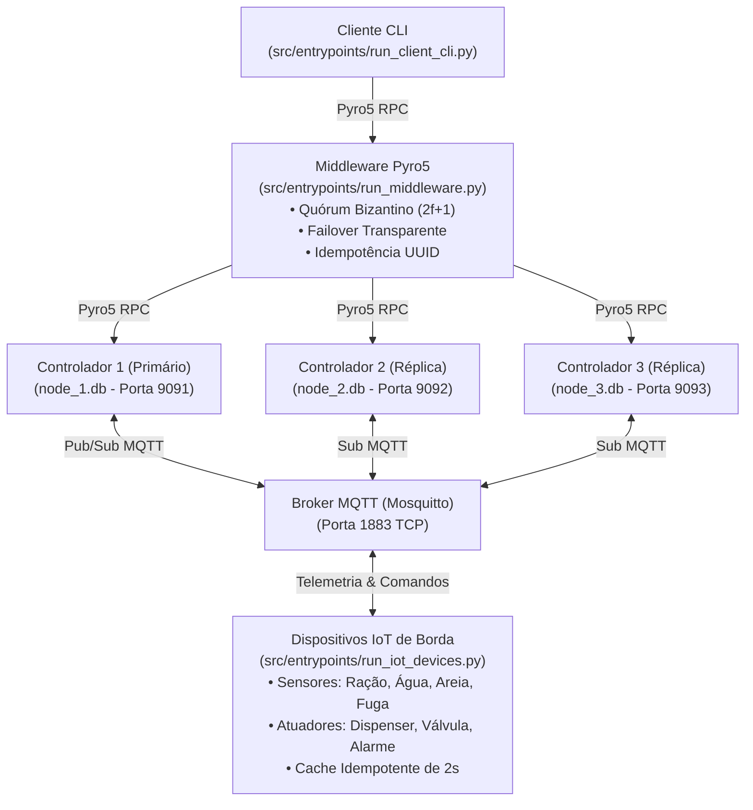

# Sistema IoT Distribuído de Pet Care

Trabalho Prático de Sistemas Distribuídos implementando controle autônomo, persistência com semântica *exactly-once*, consenso por quórum bizantino ($2f + 1$), failover transparente e comunicação desacoplada via RPC (Pyro5) e mensageria publish/subscribe (MQTT).

---

## 1. Topologia e Arquitetura do Sistema



### 1.1. Tabela de Portas e Endpoints

| Componente | Protocolo | Endereço / Porta | Identificador Pyro5 |
| :--- | :--- | :--- | :--- |
| **Broker MQTT** | TCP / MQTT | `localhost:1883` | N/A |
| **Middleware** | TCP / Pyro5 RPC | `localhost:9090` | `petcare.middleware` |
| **Controlador 1** | TCP / Pyro5 RPC | `localhost:9091` | `petcare.controller.1` |
| **Controlador 2** | TCP / Pyro5 RPC | `localhost:9092` | `petcare.controller.2` |
| **Controlador 3** | TCP / Pyro5 RPC | `localhost:9093` | `petcare.controller.3` |

---

## 2. Modelagem de Dados, Tópicos MQTT e Persistência

### 2.1. Taxonomia de Tópicos MQTT
* **Telemetria dos Sensores de Borda (QoS 1):**
  * `petcare/sensores/racao`: `{"nivel_gramas": 180.0, "timestamp": "..."}`
  * `petcare/sensores/agua`: `{"nivel_ml": 420.0, "timestamp": "..."}`
  * `petcare/sensores/areia`: `{"usos_acumulados": 2, "timestamp": "..."}`
  * `petcare/sensores/fuga`: `{"perimetro": "DENTRO", "timestamp": "..."}` (ou `"FORA"`)

* **Comandos para Atuadores de Borda (QoS 2):**
  * `petcare/atuadores/dispenser`: `{"acao": "LIBERAR_RACAO", "quantidade_gramas": 50.0, "command_id": "uuid"}`
  * `petcare/atuadores/valvula`: `{"acao": "REPOR_AGUA", "quantidade_ml": 200.0, "command_id": "uuid"}`
  * `petcare/atuadores/alarme`: `{"acao": "DISPARAR_ALARME", "motivo": "FUGA_DETECTADA", "command_id": "uuid"}` (ou `{"acao": "SILENCIAR_ALARME", "command_id": "uuid"}`)

### 2.2. Esquema Relacional de Cada Réplica SQLite (`node_{id}.db`)
```sql
CREATE TABLE IF NOT EXISTS pet_state (
    id INTEGER PRIMARY KEY CHECK (id = 1),
    racao_gramas REAL NOT NULL,
    agua_ml REAL NOT NULL,
    areia_usos INTEGER NOT NULL,
    status_fuga TEXT NOT NULL,
    alarme_ativo INTEGER NOT NULL,
    atualizado_em TEXT NOT NULL
);

CREATE TABLE IF NOT EXISTS event_log (
    command_id TEXT PRIMARY KEY,
    tipo_evento TEXT NOT NULL,
    payload TEXT NOT NULL,
    registrado_em TEXT NOT NULL
);
```

---

## 3. Garantias e Propriedades do Sistema Distribuído

1. **Quórum Bizantino Concorrente ($2f + 1, N=3, f=1$):**
   - O Middleware consulta as 3 réplicas em paralelo via `ThreadPoolExecutor` com timeout de $1.0\text{ s}$.
   - O estado retornado é agrupado pelo `state_hash()` (hash SHA-256 canônico que normaliza floats e ignora timestamps voláteis locais).
   - Requer concordância de pelo menos 2 nós ($\ge 2f + 1$). Se um nó divergir (ex: `--corrupt`), a resposta errônea é descartada e um alerta explícito de segurança é registrado.
2. **Failover Transparente de Liderança:**
   - Comandos são direcionados ao Nó Primário.
   - Em caso de queda ou indisponibilidade, o Middleware promove automaticamente a próxima réplica saudável (`set_primary(True)`), executa o comando e replica aos nós ativos com o mesmo `command_id`.
3. **Idempotência e Semântica Exactly-Once:**
   - Todo comando manual ou autônomo carrega um `command_id` UUID único.
   - Os controladores registram o ID na tabela `event_log`; retransmissões são detectadas e não causam efeito duplicado.
   - O simulador de atuadores mantém um cache em janela deslizante de $2\text{ s}$ para absorver retransmissões de rede na borda.
4. **Regras Autônomas e Proteção de Borda:**
   - Se `racao_gramas < 50.0g`: emite `LIBERAR_RACAO` ($+50\text{ g}$).
   - Se `agua_ml < 150.0ml`: emite `REPOR_AGUA` ($+200\text{ ml}$).
   - Se `status_fuga == "FORA"`: emite `DISPARAR_ALARME`.
   - **Prevenção de Triplicação:** Apenas a réplica com flag `--primary` publica comandos autônomos no MQTT.
5. **Sincronização de Boot (Catch-up):**
   - Réplicas que reinicializam após queda consultam seus pares via RPC para clonar o estado mais recente antes de responderem ao quórum.

---

## 4. Pré-requisitos e Instalação

1. **Python 3.10+** (testado em Python 3.10 a 3.14)
2. **Docker** (para execução do Mosquitto MQTT)

Instalação em ambiente virtual:
```bash
python3 -m venv .venv
source .venv/bin/activate
pip install -r requirements.txt
```

---

## 5. Como Executar o Sistema

### 5.1. Inicialização Automática Completa (Recomendado)
Um único comando inicializa o broker Docker, os 3 controladores, o middleware, o simulador de dispositivos IoT e abre o dashboard do cliente CLI interativo:

```bash
./scripts/start_system.sh
```

> **Dica:** Os logs de cada processo em segundo plano ficam gravados em `./logs/` (`controller_1.log`, `controller_2.log`, `controller_3.log`, `middleware.log`, `iot_devices.log`).
> Ao sair do cliente (Opção `0` ou `Ctrl+C`), todos os processos em segundo plano são finalizados automaticamente.

---

### 5.2. Inicialização Manual Passo a Passo (Múltiplos Terminais)

Abra terminais independentes a partir da raiz do repositório:

#### Terminal 0: Iniciar Broker MQTT
```bash
docker compose up -d
```

#### Terminal 1: Iniciar Controlador 1 (Líder Primário)
```bash
.venv/bin/python src/entrypoints/run_controller.py --id 1 --primary
```

#### Terminal 2: Iniciar Controlador 2 (Réplica Secundária)
```bash
.venv/bin/python src/entrypoints/run_controller.py --id 2
```

#### Terminal 3: Iniciar Controlador 3 (Réplica Secundária)
```bash
.venv/bin/python src/entrypoints/run_controller.py --id 3
```
> *(Para injetar falha bizantina no Nó 3, adicione `--corrupt`).*

#### Terminal 4: Iniciar o Middleware
```bash
.venv/bin/python src/entrypoints/run_middleware.py
```

#### Terminal 5: Iniciar o Simulador de Borda (Sensores e Atuadores)
```bash
.venv/bin/python src/entrypoints/run_iot_devices.py
```

#### Terminal 6: Iniciar o Cliente CLI do Tutor
```bash
.venv/bin/python src/entrypoints/run_client_cli.py
```

**Interface Interativa:**
```text
==================================================
           SISTEMA IOT PET CARE - DASHBOARD       
==================================================
 [1] Visualizar Status Geral do Pet
 [2] Dispensar Ração Manualmente
 [3] Abastecer Água Manualmente
 [4] Resetar Caixa de Areia (Registrar Limpeza)
 [5] Silenciar / Desarmar Alarme de Fuga
 [0] Sair
==================================================
```

---

## 6. Testes Automatizados e Suíte de Auditoria

### 6.1. Suíte dos 4 Cenários Experimentais
Executa a validação distribuída dos 4 cenários críticos exigidos na especificação sem precisar subir os daemons manualmente:

```bash
.venv/bin/python scripts/run_audit_suite.py
```

**Cenários avaliados:**
* **Cenário 1 (Replicação Nominal):** 3 nós convergem para estados idênticos sob telemetria síncrona com despacho único nos atuadores físicos.
* **Cenário 2 (Failover Crash-Stop):** Queda forçada do Controlador 1, failover em $\le 1.0\text{ s}$ promovendo o Controlador 2 e sincronização de boot (*catch-up*) do Controlador 1 ao retornar.
* **Cenário 3 (Falha Bizantina):** Injeção de resposta maliciosa no Controlador 3 (`--corrupt`), descarte por maioria $2 \times 1$ no Middleware e geração de alerta de segurança.
* **Cenário 4 (Sanitização de Borda):** Rejeição de telemetria corrompida (`{"nivel_ml": -150.0}`) pelo `TelemetrySanityValidator`, preservando os dados persistidos no banco.

---

### 6.2. Suíte de Testes Unitários e de Integração (Pytest)
```bash
.venv/bin/pytest
```
*Total de 50 testes cobrindo entidades, validadores, contratos, repositório SQLite, casos de uso, adaptadores MQTT/Pyro5 e entrypoints.*
