# Arquitetura, Topologia e Modelagem de Dados

---

## 1. Topologia do Sistema

```mermaid
flowchart LR
    WEB["Painel Web / Ponte HTTP-SSE\n(app/web_server.py - Porta 8080)\n- HTTP /api/action & SSE /api/events\n- PushReceiver (petcare.web.observer)\n- ProcessManager (app/process_manager.py)"]

    CLI["Cliente RPC Pyro5\n(app/client.py - Porta 9094)\n- ClusterRpcClient (petcare.client)\n- PushReceiver (petcare.client.observer)\n- Quorum Bizantino (2f+1) & Idempotencia UUID"]

    subgraph MIDDLEWARE["MIDDLEWARE (Infraestrutura Distribuida)"]
        direction TB
        C1["Controlador 1 (Lider)\n(node_1.db - Porta 9091)"]
        C2["Controlador 2 (Replica)\n(node_2.db - Porta 9092)"]
        C3["Controlador 3 (Replica)\n(node_3.db - Porta 9093)"]

        C1 <-->|"Sync P2P (sync_state) &\nFailover P2P (Pyro5 RPC)"| C2
        C2 <-->|"Sync P2P (sync_state) &\nFailover P2P (Pyro5 RPC)"| C3
        C1 <-->|"Sync P2P (sync_state) &\nFailover P2P (Pyro5 RPC)"| C3
    end

    MQTT["Broker MQTT (Mosquitto)\n(Porta 1883 TCP)"]

    IOT["Dispositivos IoT de Borda\n(app/sensors.py - IoTDeviceNode)\n- Sensores: Racao, Agua, Areia, Fuga\n- Atuadores: Dispenser, Valvula, Alarme\n- Deduplicacao (janela de 2s)"]

    WEB <-->|"Pyro5 RPC + Push Observer"| CLI

    CLI <-->|"Pyro5 RPC + Push Observer"| C1
    CLI <-->|"Pyro5 RPC + Push Observer"| C2
    CLI <-->|"Pyro5 RPC + Push Observer"| C3

    C1 <-->|"Pub/Sub MQTT (Ativo)"| MQTT
    C2 <-->|"Sub MQTT (Standby)"| MQTT
    C3 <-->|"Sub MQTT (Standby)"| MQTT

    MQTT <-->|"Telemetria & Atuacao"| IOT
```



---

## 2. Portas, Protocolos e Objetos Remotos

| Componente | Protocolo | Endereço | Objeto Pyro5 / Recurso |
| :--- | :--- | :--- | :--- |
| **Servidor Web (Ponte HTTP/SSE)** | HTTP / SSE / Pyro5 | `localhost:8080` (HTTP) / Porta efêmera (Pyro5) | `petcare.web.observer` (`PushReceiver`) |
| **Cliente RPC Pyro5** | TCP / Pyro5 RPC | `localhost:9094` | `petcare.client` (`ClusterRpcClient`) e `petcare.client.observer` (`PushReceiver`) |
| **Broker MQTT (Mosquitto)** | TCP / MQTT | `localhost:1883` | N/A |
| **Controlador 1** | TCP / Pyro5 RPC | `localhost:9091` | `petcare.controller.1` (`PetController`) |
| **Controlador 2** | TCP / Pyro5 RPC | `localhost:9092` | `petcare.controller.2` (`PetController`) |
| **Controlador 3** | TCP / Pyro5 RPC | `localhost:9093` | `petcare.controller.3` (`PetController`) |

---

## 3. Contratos de Mensageria MQTT

### 3.1. Telemetria de Sensores (`QoS 1`)

Publicada pelo processo de borda (`app/sensors.py`) e assinada por todos os controladores (`petcare/sensores/#`).

| Tópico | Payload JSON | Limites e Validação (`app/domain.py`) |
| :--- | :--- | :--- |
| `petcare/sensores/racao` | `{"nivel_gramas": 180.0}` | `float` no intervalo `[0.0, 500.0]` |
| `petcare/sensores/agua` | `{"nivel_ml": 420.0}` | `float` no intervalo `[0.0, 1000.0]` |
| `petcare/sensores/areia` | `{"usos_acumulados": 2}` | `int >= 0` |
| `petcare/sensores/fuga` | `{"perimetro": "DENTRO"}` | `"DENTRO"` ou `"FORA"` (se `"FORA"`, aciona alarme) |

### 3.2. Comandos para Atuadores (`QoS 2`)

Publicados pelo Controlador Líder e assinados pelos dispositivos de borda (`petcare/atuadores/#`).

| Tópico | Payload JSON | Gatilho |
| :--- | :--- | :--- |
| `petcare/atuadores/dispenser` | `{"acao": "LIBERAR_RACAO", "quantidade_gramas": 50.0, "command_id": "<uuid>"}` | Comando RPC `LIBERAR_RACAO` (`+50g`, teto `500g`) |
| `petcare/atuadores/valvula` | `{"acao": "REPOR_AGUA", "quantidade_ml": 200.0, "command_id": "<uuid>"}` | Comando RPC `REPOR_AGUA` (`+200ml`, teto `1000ml`) |
| `petcare/atuadores/alarme` | `{"acao": "DISPARAR_ALARME", "motivo": "FUGA_DETECTADA", "command_id": "<uuid>"}` | Telemetria de fuga com `perimetro == "FORA"` |
| `petcare/atuadores/alarme` | `{"acao": "SILENCIAR_ALARME", "command_id": "<uuid>"}` | Comando RPC `SILENCIAR_ALARME` |

### 3.3. Controle do Simulador de Borda (`QoS 1`)

| Tópico | Payload JSON | Descrição |
| :--- | :--- | :--- |
| `petcare/sim/control` | `{"kind": "auto", "enabled": true}` | Ativa/desativa o ciclo automático de consumo a cada 4s |
| `petcare/sim/control` | `{"kind": "telemetry", "sensor": "racao", "payload": {"nivel_gramas": 30}}` | Dispara publicação de telemetria pelo nó IoT |

---

## 4. Interface Remota Pyro5 RPC

### 4.1. `PetController` (`petcare.controller.{1,2,3}`)

* `ping() -> dict`: Retorna `id`, `is_primary`, `byzantine` e `hash` canônico SHA-256 (12 caracteres).
* `get_state() -> dict`: Retorna o snapshot completo de `PetState` acrescido de metadados do nó e `hash`.
* `sync_state(state_dict, command_id, kind, payload) -> bool`: Replica estado e evento do Líder nas réplicas secundárias.
* `execute_command(action, command_id) -> dict`: Executa transição de comando no Líder com verificação de idempotência em `event_log`, aciona atuadores MQTT e replica via P2P.
* `set_primary(flag) -> bool`: Promove ou rebaixa o papel do controlador.
* `set_byzantine(flag) -> bool`: Ativa/desativa simulação de falha bizantina (quando desativada, executa catch-up imediato a partir do Líder).
* `register_observer(client_uri)` / `unregister_observer(client_uri)`: Gerencia clientes inscritos para notificações push.

### 4.2. `ClusterRpcClient` (`petcare.client`) e `PushReceiver` (`petcare.client.observer` / `petcare.web.observer`)

* **Métodos expostos por `ClusterRpcClient` (`localhost:9094`):**
  * `get_nodes_status()` / `get_last_consensus()` / `get_consensus_state(log_result=True, enforce_leader=True)`: Consulta os nós em paralelo, apura o quórum $2f+1$ e destitui líder divergente se necessário.
  * `execute_command(action, command_id=None)`: Pré-valida o quórum $2f+1$, localiza ou elege o Líder e executa o comando com failover transparente mantendo o mesmo `command_id`.
  * `promote_node(target_id)` / `set_byzantine(target_id, flag)`: Controla liderança e simulação bizantina nos controladores.
  * `register_observer_on_node(node_id)` / `register_ui_observer(ui_uri)` / `unregister_ui_observer(ui_uri)`: Gerencia inscrições de push entre controladores, cliente RPC e painel web.
* **Notificação push via `PushReceiver.on_push(payload)` (`@Pyro5.api.oneway`):**
  * `petcare.client.observer` recebe notificações dos controladores e aplica *debounce* de `80ms` antes de reavaliar o consenso.
  * `petcare.web.observer` recebe o resultado do consenso empurrado pelo `ClusterRpcClient` para atualizar o stream SSE do painel web.

---

## 5. Persistência Local Replicada (`node_{1,2,3}.db`)

Cada controlador mantém seu próprio banco SQLite isolado (`app/storage.py`):

```sql
CREATE TABLE IF NOT EXISTS pet_state (
    id INTEGER PRIMARY KEY CHECK (id = 1),
    racao_gramas REAL NOT NULL,
    agua_ml REAL NOT NULL,
    areia_usos INTEGER NOT NULL,
    status_fuga TEXT NOT NULL,
    alarme_ativo INTEGER NOT NULL,
    atualizado_em TEXT NOT NULL
);

CREATE TABLE IF NOT EXISTS event_log (
    command_id TEXT PRIMARY KEY,
    tipo_evento TEXT NOT NULL,
    payload TEXT NOT NULL,
    registrado_em TEXT NOT NULL
);
```

O hash canônico (`PetState.canonical_hash()`) é calculado com `SHA-256` (truncado em 12 hexadecimais) sobre o JSON ordenado dos campos de estado (`racao_gramas` e `agua_ml` arredondados para 2 casas decimais, `areia_usos`, `status_fuga`, `alarme_ativo`), excluindo `atualizado_em` para garantir comparação determinística entre réplicas.

---

## 6. Estrutura de Módulos

```text
.
├── app/
│   ├── config.py          # Constantes de cluster (ALL_NODES, BASE_PORT=9090, CLIENT_PORT=9094, MQTT_HOST/PORT)
│   ├── domain.py          # Entidade PetState, hash canonico, validacao fisica e regras de transicao
│   ├── storage.py         # Persistencia SQLite por replica (NodeStorage: pet_state + event_log)
│   ├── infra.py           # Utilitarios compartilhados: Pyro5 (rpc_proxy, PushReceiver, ObserverRegistry), MQTT e sinais
│   ├── process_manager.py # Orquestracao de subprocessos (controladores, sensors e client)
│   ├── controller.py      # Processo Pyro5 do controlador, consumidor/produtor MQTT, sync e failover P2P
│   ├── client.py          # Processo Pyro5 do cliente RPC (:9094): quorum 2f+1, failover RPC e push UI
│   ├── sensors.py         # Processo IoT de borda (IoTDeviceNode: sensores, atuadores e deduplicacao)
│   ├── event_bus.py       # Barramento de logs estruturados em JSONL (logs/events.jsonl)
│   └── web_server.py      # Servidor HTTP/SSE (:8080), API /api/action e ponte com client, SQLite e MQTT
├── web/
│   ├── index.html         # Fluxograma interativo em board infinito
│   ├── style.css          # Estilos da interface web
│   └── app.js             # Renderizacao SVG das arestas, cliente SSE e despacho de acoes
├── scripts/
│   └── start_system.sh    # Script de inicializacao (Mosquitto + web_server + subprocessos)
├── docker-compose.yml     # Container Eclipse Mosquitto 2 (:1883)
├── mosquitto.conf         # Configuracao do broker MQTT
└── requirements.txt       # Dependencias Python (paho-mqtt, Pyro5)
```

