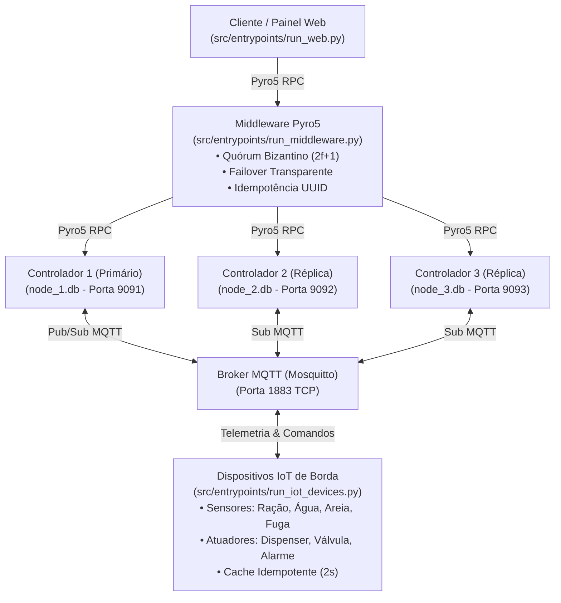

# Arquitetura, Topologia e Modelagem de Dados

---

## 1. Topologia do Sistema



---

## 2. Portas, Protocolos e Endpoints

| Componente | Protocolo | Endereço | Objeto Pyro5 |
| :--- | :--- | :--- | :--- |
| **Painel Web / Gateway** | HTTP REST / SSE | `localhost:8080` | N/A |
| **Broker MQTT** | TCP / MQTT | `localhost:1883` | N/A |
| **Middleware** | TCP / Pyro5 RPC | `localhost:9090` | `petcare.middleware` |
| **Controlador 1** | TCP / Pyro5 RPC | `localhost:9091` | `petcare.controller.1` |
| **Controlador 2** | TCP / Pyro5 RPC | `localhost:9092` | `petcare.controller.2` |
| **Controlador 3** | TCP / Pyro5 RPC | `localhost:9093` | `petcare.controller.3` |

---

## 3. Contratos de Mensageria MQTT

### 3.1. Telemetria de Sensores (QoS 1)
| Tópico | Exemplo de Payload JSON |
| :--- | :--- |
| `petcare/sensores/racao` | `{"nivel_gramas": 180.0, "timestamp": "2026-11-12T18:00:00Z"}` |
| `petcare/sensores/agua` | `{"nivel_ml": 420.0, "timestamp": "2026-11-12T18:00:00Z"}` |
| `petcare/sensores/areia` | `{"usos_acumulados": 2, "timestamp": "2026-11-12T18:00:00Z"}` |
| `petcare/sensores/fuga` | `{"perimetro": "DENTRO", "timestamp": "2026-11-12T18:00:00Z"}` |

### 3.2. Comandos para Atuadores (QoS 2)
| Tópico | Exemplo de Payload JSON |
| :--- | :--- |
| `petcare/atuadores/dispenser` | `{"acao": "LIBERAR_RACAO", "quantidade_gramas": 50.0, "command_id": "uuid"}` |
| `petcare/atuadores/valvula` | `{"acao": "REPOR_AGUA", "quantidade_ml": 200.0, "command_id": "uuid"}` |
| `petcare/atuadores/alarme` | `{"acao": "DISPARAR_ALARME", "motivo": "FUGA_DETECTADA", "command_id": "uuid"}` ou `{"acao": "SILENCIAR_ALARME", "command_id": "uuid"}` |

---

## 4. Persistência Local em Cada Réplica (`node_{id}.db`)

```sql
CREATE TABLE IF NOT EXISTS pet_state (
    id INTEGER PRIMARY KEY CHECK (id = 1),
    racao_gramas REAL NOT NULL,
    agua_ml REAL NOT NULL,
    areia_usos INTEGER NOT NULL,
    status_fuga TEXT NOT NULL,
    alarme_ativo INTEGER NOT NULL,
    atualizado_em TEXT NOT NULL
);

CREATE TABLE IF NOT EXISTS event_log (
    command_id TEXT PRIMARY KEY,
    tipo_evento TEXT NOT NULL,
    payload TEXT NOT NULL,
    registrado_em TEXT NOT NULL
);
```

---

## 5. Estrutura de Diretórios (Clean Architecture)

* `src/domain/`: Entidades (`PetState`, `Command`, `CommandResult`), contratos (`ControllerNode`, `StateRepository`, `BrokerClient`), exceções e `TelemetrySanityValidator`.
* `src/use_cases/`: Regras de negócio dos controladores (`ControllerService`) e do middleware (`MiddlewareService`).
* `src/adapters/`: Persistência SQLite (`SqliteRepository`), cliente MQTT (`MqttClient`), objetos remotos Pyro5 (`PyroGateway`) e gateway HTTP/SSE (`WebGateway`).
* `src/entrypoints/`: Scripts de inicialização de processos (`run_controller.py`, `run_middleware.py`, `run_iot_devices.py`, `run_web.py`).
* `web/`: Interface SPA (HTML, CSS, JS e especificação OpenAPI/Swagger).
* `tests/`: Suíte de testes unitários e de integração espelhando as camadas de código.

