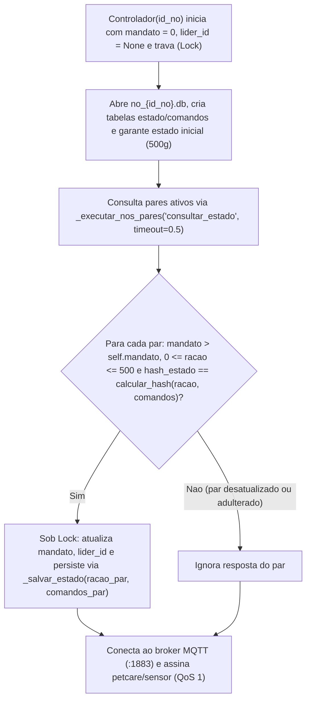
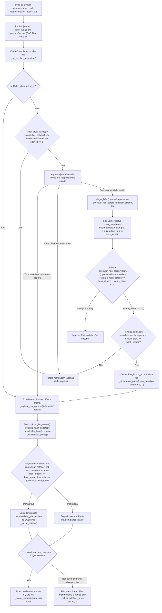
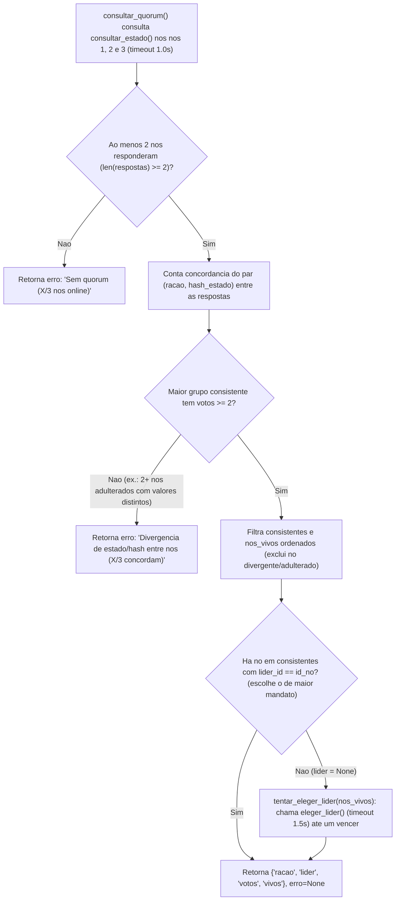
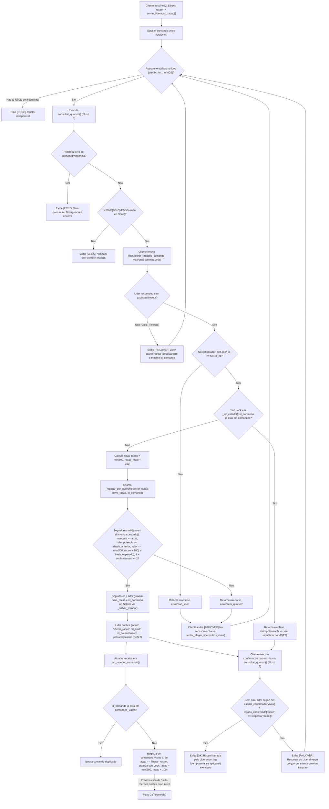

# Árvores de Decisão — Fluxo do Sistema Pet Care

## 1. Inicialização e Catch-up do Controlador (`controlador.py`)

---

## 2. Fluxo de Telemetria e Eleição Automática (`sensor_atuador.py` -> `controlador.py`)

---

## 3. Consulta de Quórum e Descoberta de Líder (`cliente.py` — opção `[1]` e base da `[2]`)

---

## 4. Fluxo de Ação para o Atuador, Idempotência e Failover (`cliente.py` -> `controlador.py` -> `sensor_atuador.py`)

